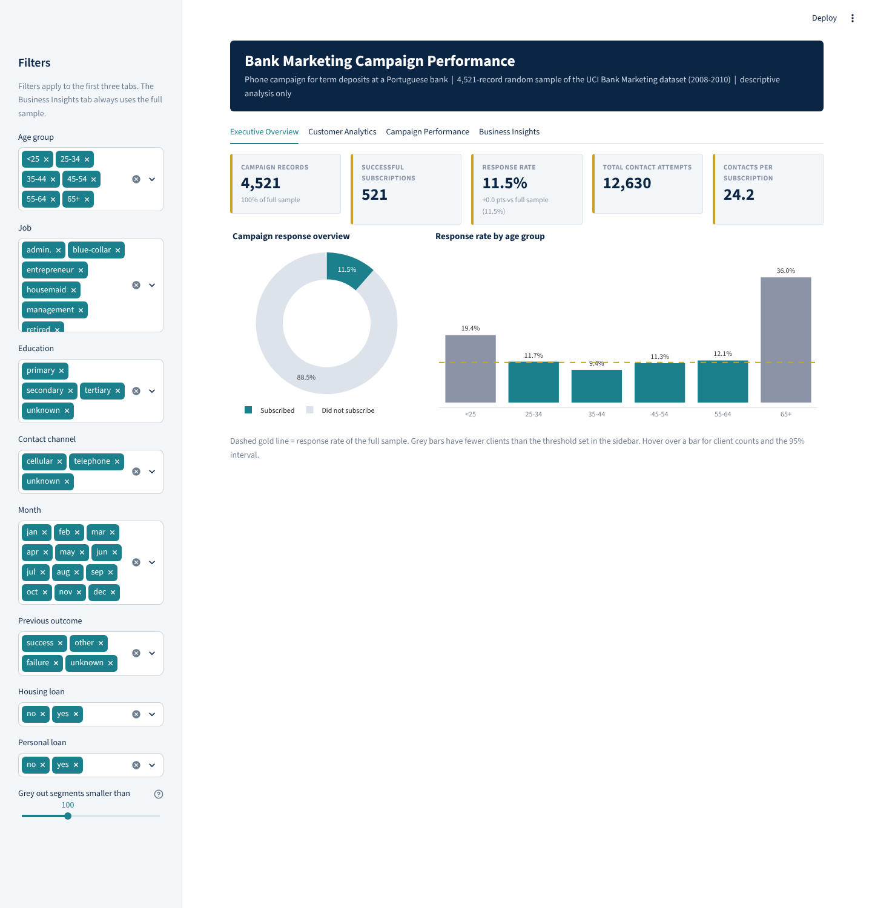
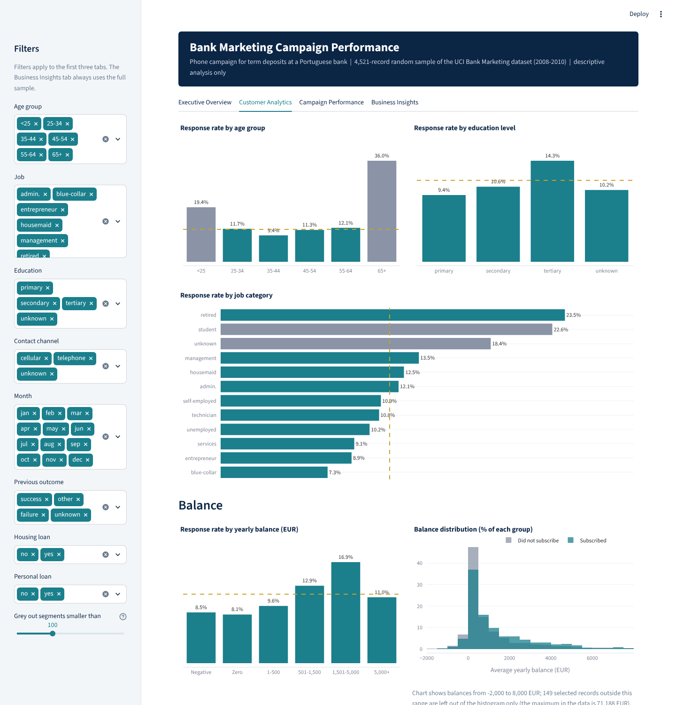
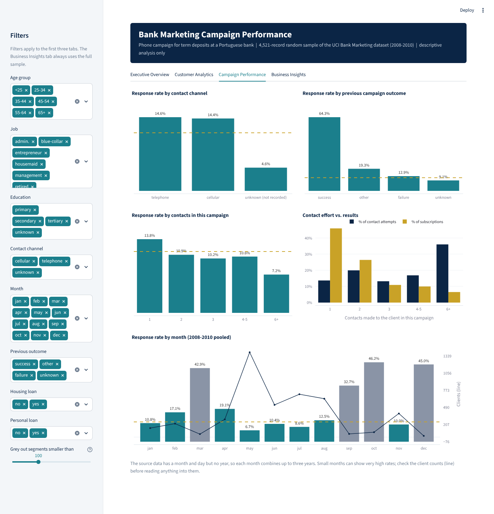

# Bank Marketing Campaign Performance Analysis

### 🌐 Live Interactive Dashboard

**[🚀 Explore the Streamlit Dashboard](https://imerhemet816-lgtm-bank-marketing-campai-appstreamlit-app-wfpau6.streamlit.app/)**

Explore campaign KPIs, customer segmentation, conversion rates,
interactive visualizations, and business insights.

An analysis of a Portuguese bank's phone campaign for term deposits. It covers data cleaning in Python, a cross-check in MySQL, an Excel workbook, a static dashboard image and an interactive Streamlit dashboard.



## Business problem

The bank phoned clients to sell a term deposit. Some clients were called once and others more than six times, and about one in nine said yes. This project tries to answer a few practical questions from the data:

- What was the overall response rate, and how many contact attempts did each subscription take?
- Which client groups (age, job, education, loans, balance) responded more or less than average?
- Did the contact channel, the month, or the number of attempts matter?
- How much did the outcome of a previous campaign tell us about this one?

## Dataset

- **Source:** UCI Machine Learning Repository, *Bank Marketing* dataset (also on Kaggle). Created by Sérgio Moro and Paulo Cortez; described in Moro, Laureano and Cortez (2011).
- **File used:** `bank.csv`, a 10% random sample of the full dataset: 4,521 records, 16 input columns and the outcome `y` (subscribed yes/no).
- **Files not used:** the original upload also had `test.csv` (427 rows, no outcome column, all from May) and `sample_submission_.csv` (a constant 0.5 placeholder). Without an outcome they cannot support a campaign analysis. See [docs/data_inspection.md](docs/data_inspection.md).

## Technologies

| Tool | Used for |
|---|---|
| Python (pandas, NumPy) | Cleaning, validation, segment analysis |
| Matplotlib | Static one-page dashboard and individual charts |
| Streamlit and Plotly | Interactive dashboard |
| MySQL 8.0 | 19 analysis queries, used to cross-check the pandas results |
| Excel (written with XlsxWriter) | Workbook with COUNTIFS formulas and charts |

A Power BI build specification with DAX measures is included in `docs/`. **No Power BI report (.pbix) was built**, and the DAX has not been run in Power BI.

## Methodology

1. **Inspect** the files: row counts, types, missing values, duplicates, unusual values, and how `pdays = -1` relates to `previous` and `poutcome`.
2. **Clean** with a script that validates the data and writes `data/processed/bank_clean.csv`.
3. **Explore** response rates by segment. Each rate comes with a 95% Wilson interval. I used Wilson rather than the simple normal approximation because several segments are small, where the simple version gives poor intervals.
4. **Repeat the analysis in SQL** and compare it with the pandas results.
5. **Present** the results as a static dashboard, an Excel workbook and the Streamlit app.

## Data cleaning

The raw file was already tidy: no missing values, no duplicate rows, and categories that match the source documentation. The cleaning mainly prepares the data for analysis.

| Decision | Reason |
|---|---|
| Kept `unknown` as its own category in `job`, `education`, `contact`, `poutcome` | Imputing would be guessing. `poutcome = unknown` means no earlier campaign, and `contact = unknown` behaves very differently from the other channels (see results). |
| `pdays = -1` copied to a new column as blank, original kept | -1 means "never contacted". Averaging it with real day counts would be meaningless. |
| Kept 366 negative balances and the 71,188 EUR maximum | They look like genuine overdrafts and large accounts, not entry errors. |
| Renamed `default` to `credit_default` and `y` to `subscribed` | `default` is a reserved word in SQL. |
| Added `subscribed_flag`, `age_group`, `balance_band`, `campaign_band`, `month_num` | For grouping and for sorting months in calendar order. |
| No date column created | The data has a month and day but no year. |
| `duration` kept but not used to rank segments | It is only known after the call ends. |

## Analytical results

Baseline: **11.5%** of 4,521 clients subscribed (521), using 12,630 contact attempts, or 24.2 attempts per subscription.

- **Previous success is the strongest signal.** 64.3% of clients with a previous "success" subscribed again (83 of 129), against 9.1% of clients never contacted before.
- **Repeat contact has diminishing returns.** Clients contacted 6 or more times took 36.1% of all contact attempts and produced 6.5% of subscriptions. Their response rate was 7.2%, against 13.8% for clients contacted once.
- **The "unknown" contact channel converts poorly:** 4.6% against about 14.4% to 14.6% for cellular and telephone, and the gap holds within May and June.
- **May is the largest month and the weakest:** 30.9% of records, 6.7% response.
- **Clients with no housing loan and no personal loan respond more:** 16.9% against 6.2% to 9.1% for the other loan combinations.
- **Retired clients (23.5%) and clients aged 65+ (36.0%) respond most**, but the 65+ group has only 89 clients.

The evidence, a recommendation and the limitations for each finding are in [docs/business_insights.md](docs/business_insights.md).

## Dashboard

### Streamlit app (`app/streamlit_app.py`)

Four tabs:

- **Executive Overview:** campaign records, successful subscriptions, response rate (with the difference from the full sample), total contact attempts, contacts per subscription, a response donut and the age-group chart.
- **Customer Analytics:** response rate by age group, education and job, response rate by balance band, and a balance histogram for subscribers and non-subscribers.
- **Campaign Performance:** response by contact channel, previous outcome, number of contacts, contact effort versus results, and by month with the client count per month.
- **Business Insights:** seven findings with evidence, recommendation and limitation, plus the limitations of the analysis. Numbers on this tab are calculated from the full sample when the page loads, not typed in.

The sidebar filters (age group, job, education, contact channel, month, previous outcome, housing loan, personal loan) update the first three tabs. A slider greys out segments with fewer clients than a chosen threshold, and hovering over a bar shows client counts and the 95% interval.

| | |
|---|---|
|  |  |

`outputs/charts/dashboard.png` is a separate static version made with Matplotlib.

## Project structure

```
bank-marketing-analysis/
├── app/streamlit_app.py              # interactive dashboard
├── .streamlit/config.toml            # colour theme
├── data/
│   ├── raw/bank.csv                  # original file (semicolon-separated)
│   └── processed/bank_clean.csv      # output of 01_clean_data.py
├── src/
│   ├── 01_clean_data.py              # checks and cleaning
│   ├── 02_eda.py                     # segment tables and summary statistics
│   ├── 03_dashboard.py               # static dashboard.png and chart PNGs
│   ├── 04_build_excel.py             # Excel workbook with formulas
│   └── validate_kpis.py              # recomputes KPIs from the raw file
├── sql/bank_marketing_analysis.sql   # schema, load, 19 queries (MySQL 8.0)
├── excel/bank_marketing_analysis.xlsx
├── outputs/charts/                   # static dashboard and chart PNGs
├── outputs/tables/                   # CSV output from 02_eda.py
├── docs/
│   ├── screenshots/                  # Streamlit screenshots
│   ├── business_insights.md
│   ├── data_dictionary.md
│   ├── data_inspection.md
│   ├── powerbi_dashboard_spec.md     # specification only, no .pbix
│   ├── powerbi_theme.json
│   └── linkedin_post.md
├── requirements.txt
└── README.md
```

## Local installation

The project was run with Python 3.12. Commands assume you are in the repository folder.

```bash
# 1. create and activate a virtual environment
python -m venv .venv
source .venv/bin/activate          # Windows: .venv\Scripts\activate

# 2. install dependencies
pip install -r requirements.txt

# 3. rebuild the cleaned data, tables, charts and workbook
python src/01_clean_data.py
python src/02_eda.py
python src/03_dashboard.py
python src/04_build_excel.py

# 4. check the headline KPIs against the raw file
python src/validate_kpis.py

# 5. start the dashboard (opens at http://localhost:8501)
streamlit run app/streamlit_app.py
```

The cleaned CSV is already in the repository, so step 5 works without steps 3 and 4.

### MySQL

From the repository folder, with MySQL 8.0 and `local_infile` enabled (`SET GLOBAL local_infile = 1;` as an admin user):

```bash
mysql --local-infile=1 -u <user> -p < sql/bank_marketing_analysis.sql
```

The script creates a `bank_marketing` database and a `campaign_contacts` table, loads the cleaned CSV and runs the queries, each with a comment stating the business question. It does not drop anything. If the table already exists, the run stops at the `CREATE TABLE` statement; the comment at the top of the script shows the one statement to run first if you want to start over.

## Deploying the Streamlit app

## Live Streamlit Application

The interactive dashboard has been deployed using Streamlit Community Cloud.

**Live Dashboard:** [Open Application](https://imerhemet816-lgtm-bank-marketing-campai-appstreamlit-app-wfpau6.streamlit.app/)

The dashboard includes four interactive sections:
- Executive Overview
- Customer Analytics
- Campaign Performance
- Business Insights

Users can explore customer segments, campaign conversion rates,
marketing effectiveness, and data-driven business recommendations.

## What was verified

Checked by running the code during the last update:

- All four scripts in `src/` ran end to end, and pyflakes reported no issues in any Python file.
- `src/validate_kpis.py` recalculated records, subscriptions, contact attempts, average age, response rate and contacts per subscription from the raw file and they match the cleaned data and the figures in this README.
- The SQL script ran without errors on MySQL 8.0.46 from an empty server, and its row count, totals and segment results matched pandas. A second run stopped at `CREATE TABLE` without touching the loaded data.
- The Excel formulas were recalculated in LibreOffice and match the pandas figures.
- The Streamlit app was exercised with Streamlit's test runner (default view, a job filter, and an empty selection) with no exceptions, and opened in headless Chromium with no error messages. The screenshots in `docs/screenshots/` come from that run.

Not verified:

- The Excel file has not been opened in Microsoft Excel.
- The DAX measures and Power BI layout have not been run in Power BI.
- The Streamlit app was checked only in headless Chromium, and not on a phone or in other browsers.
Deployment to Streamlit Community Cloud was performed; live functionality remains to be verified.

## Limitations

- The data is a 10% sample, so several segments are small (for example 20 December records and 89 clients aged 65+).
- There is no year, so months from 2008 to 2010 are pooled and no time trend can be built.
- There are no cost, revenue or deposit-size fields, so the results are response rates and not profitability.
- The bank chose whom to call, so all differences are descriptive and none show cause and effect.
- Part of the drop in response at high contact counts is built in, because clients who agree early stop being called.
- `contact = unknown` is a recording gap. It is concentrated in May and June, so channel and month are mixed together.

## Future improvements

- Use the full 45,211-row file, which has the same fields and would make small segments more reliable.
- Fit a simple logistic regression without `duration` to check which differences remain after controlling for the others.
- Rebuild the dashboard in Power BI from the existing specification.
- Add a few automated tests around the cleaning script.

## AI assistance

The scripts, SQL, dashboard and first drafts of the documents were produced with the help of an AI assistant (Claude). The figures were recomputed from the dataset and the checks above were run as described.

## Dataset attribution and license

Moro, S., Laureano, R., and Cortez, P. (2011). *Using Data Mining for Bank Direct Marketing: An Application of the CRISP-DM Methodology.* In P. Novais et al. (Eds.), Proceedings of the European Simulation and Modelling Conference, pp. 117-121, Guimarães, Portugal. EUROSIS. http://hdl.handle.net/1822/14838

The UCI repository lists the dataset under a CC BY 4.0 license; confirm the current license on the dataset page before redistributing. `data/raw/bank.csv` is included with this attribution. No license has been chosen for the code in this repository yet.
